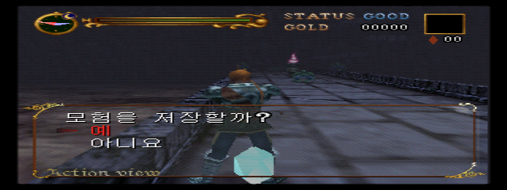
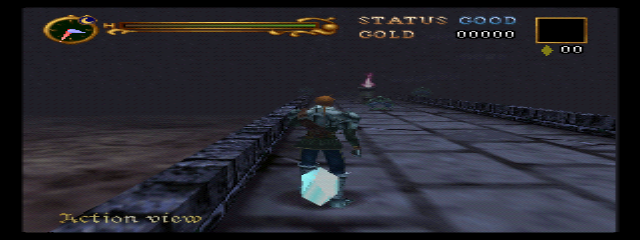
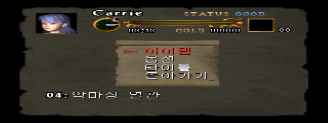
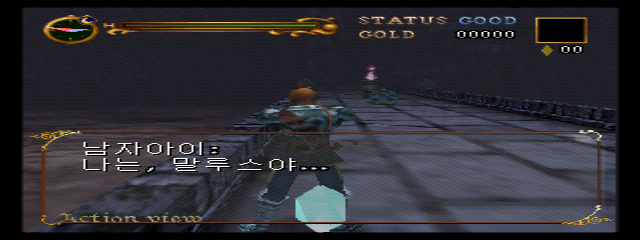
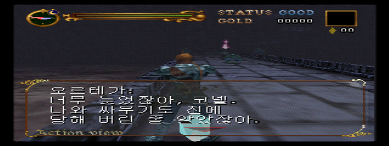
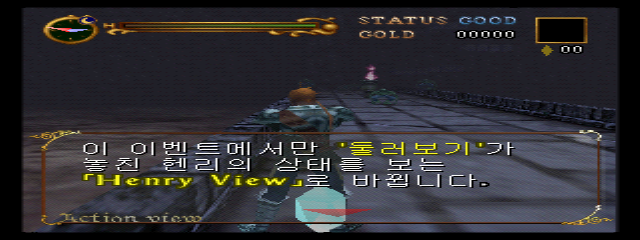
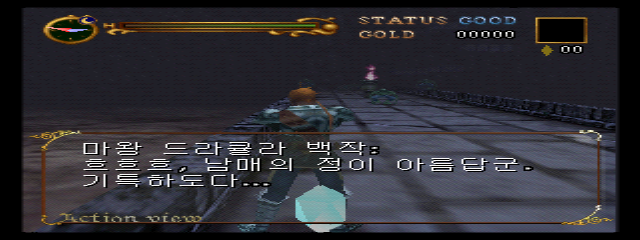

**악마성 드라큘라 묵시록 외전 · LEGEND OF CORNELL · N64 일본판 한국어 패치 V0.6**

일본어 대사·책·아이템 설명·시스템 문구·엔딩 등 **1,665개 텍스트 구간**과 일본어 타이틀 로고를 한국어로 바꿨습니다. 이전 악마성 묵시록 한국어판과 같은 기준으로 **영어 메뉴·영문 부제·영어 음성을 보존**했습니다. 컷신은 게임의 기존 자막 표시·대기 명령을 사용하며, 띄어쓰기는 반각 공백(8픽셀)입니다.

원문 1,410개(중복 포함 1,665구간)를 대조해 **126구간**을 수정했습니다. 자기소개·호칭, 감정 표현과 문장 부호, 제어탑 열쇠 명칭, 분할 대사와 고정 영문을 잇는 문법, 대기 명령 전후의 줄바꿈·공백을 검수했습니다. 공개판 **V0.6**은 검수를 마친 로컬 v1.1과 동일한 번역과 ROM 내용을 사용합니다.

Windows x64에서는 [단일 EXE 패처](https://github.com/OldManCraveGuitars-bit/N64-Akumajou-Dracula-Mokushiroku-Gaiden-Legend-of-Cornell-Kr/releases/download/V0.6/N64-Legend-of-Cornell-Kr-V0.6-Patcher.exe) 또는 [Windows ZIP](https://github.com/OldManCraveGuitars-bit/N64-Akumajou-Dracula-Mokushiroku-Gaiden-Legend-of-Cornell-Kr/releases/download/V0.6/N64-Legend-of-Cornell-Kr-V0.6-Windows.zip)을 받으세요. **Python 설치 없이 실행**합니다. [BPS 단독 패치](https://github.com/OldManCraveGuitars-bit/N64-Akumajou-Dracula-Mokushiroku-Gaiden-Legend-of-Cornell-Kr/releases/download/V0.6/Legend-of-Cornell-Korean-V0.6.bps), [텍스트 편집 도구](https://github.com/OldManCraveGuitars-bit/N64-Akumajou-Dracula-Mokushiroku-Gaiden-Legend-of-Cornell-Kr/releases/download/V0.6/Text-Tool-V0.6.zip), [스크린샷 모음](https://github.com/OldManCraveGuitars-bit/N64-Akumajou-Dracula-Mokushiroku-Gaiden-Legend-of-Cornell-Kr/releases/download/V0.6/Screenshots-V0.6.zip), [SHA256 목록](https://github.com/OldManCraveGuitars-bit/N64-Akumajou-Dracula-Mokushiroku-Gaiden-Legend-of-Cornell-Kr/releases/download/V0.6/SHA256SUMS.txt), [ROM 해시 목록](https://github.com/OldManCraveGuitars-bit/N64-Akumajou-Dracula-Mokushiroku-Gaiden-Legend-of-Cornell-Kr/releases/download/V0.6/ROM-HASHES.txt)도 제공합니다.

1. 패처 EXE를 실행하고 **일본판 원본 롬**을 선택합니다.
2. 새 출력 파일 경로를 고르고 **한글 패치 적용**을 누릅니다.
3. 완료 후 표시된 SHA256을 확인합니다.
4. 생성된 `.z64`를 새로 부팅하고 게임 안의 저장 데이터를 불러옵니다.

원본은 **16 MiB**, 결과는 **32 MiB**입니다. 확장자와 관계없이 `.z64/.v64/.n64`의 실제 바이트 순서를 자동 판별합니다. 원본과 기존 출력 파일은 덮어쓰지 않습니다. 일반 BPS 프로그램에는 big endian `.z64` 원본을 사용하세요.

다른 빌드에서 만든 빠른 저장 상태는 사용하지 마세요. 게임 내부 저장/불러오기를 사용하세요. 저장 방식을 자동 인식하지 못하면 **EEPROM 16K (16 Kbit / 2 KiB)**로 지정합니다.

원본 게임: **Akumajou Dracula Mokushiroku Gaiden - Legend of Cornell (Japan)** / 해외판 제목: **Castlevania: Legacy of Darkness**. 지원 원본 정규화 **SHA1**: `50439acb5784bea3a4bbba5188c2aeaa1442099d`

| 대상 | SHA256 |
| --- | --- |
| 원본 .z64 (big endian 정규화) | `51a0443883f3f94b20b6fb9a8688631c51bc7feafb143c51e48dc7198adfd1ca` |
| 제공된 원본 (v64 순서, 파일 확장자는 .n64) | `c90e4e11e90a8688d655f59a3ad069814cfa24c2b55e5a959588b03dc4585a65` |
| 한국어 결과 .z64 | `55d8eece2108ed6dd3691f36d5e9572b9f60acb9aacc57f626df6ccd6d26b2db` |
| Windows EXE | `4f4622595ecadba5431466102d75107962af3ebe41888479c8cbc75caead449c` |
| BPS 패치 | `67956baa0c0f88b80f5e32842542df8762b010aa74618555768e4d9414ab8083` |
| Windows ZIP | `62f93d41aca565cb9cc644d82463447dc7382f4444b1a10df4f27e12742910a6` |

EXE의 실제 실행으로 세 바이트 순서의 결과 해시 일치를 확인했습니다. 잘못된 원본·손상된 패치·원본 및 기존 출력 덮어쓰기 차단, GUI 시작, 공개 텍스트 도구의 동일 결과 재빌드도 확인했습니다.

473개 자산과 47개 지역 데이터의 압축·크기, 103개 텍스트 풀, 제어 명령·영어 보존, 전체 대사 줄 폭·페이지 높이·N64 체크섬을 검사했습니다. 영문 글꼴·타이틀 영어 부분·다른 타이틀 그래픽·음성 데이터의 원본 일치를 확인했습니다. 최종 ROM에서 **31개 번역 지역, 네 캐릭터, 실제 저장·새 부팅 불러오기, 아이템 메뉴, 네 문구의 MFDS 출력** 등 41개 실행 검사를 통과했습니다.

지역·캐릭터·문구 시험은 QA용 에뮬레이터 RAM 요청을 사용했습니다. **모든 캐릭터의 모든 분기를 처음부터 끝까지 조작해 완주한 검증은 아닙니다.** 검수용 이동·문구 출력 기능은 배포 ROM에 포함하지 않았습니다.

화이트 주얼의 한글 저장창

게임 내부 저장 완료

새 부팅 후 저장 데이터 불러오기

캐리의 아이템 메뉴와 한글 지역명

아래 네 화면은 **실제 MFDS 텍스트 엔진에 검수 문구를 요청한 출력 시험**입니다. 자연스러운 컷신 진행을 촬영한 장면은 아닙니다.

말루스 자기소개 문구 검수

오르테가 대사 검수

헨리 안내 문구 검수

드라큘라 대사 검수. 캡처 원본은 640×240이며 이 페이지에서는 4:3으로 표시합니다.

텍스트 편집 도구는 ZIP을 풀고 `Cornell_Korean_Editor.exe`로 실행합니다. 첫 실행에 지원 원본을 선택하세요. 원문·번역·ID 검색, 원본 글자와 한글 미리보기, Ctrl+S 저장, 폭·페이지·영어 보존 검증과 ROM 빌드를 지원합니다. 검색용 일본어 전사에는 오독이 있을 수 있어 원문 이미지도 함께 확인해야 합니다. 소스로 실행하려면 Python 3.11 이상과 Pillow를 준비하고 `text-tool/텍스트_도구_실행.cmd`를 실행하세요.

패처 소스 실행: `python patcher_app.py` 
EXE 빌드: `python -m pip install -r requirements-build.txt` 후 `scripts/build_exe.ps1` 실행 
패처 테스트: `CORNELL_TEST_ROM` 환경 변수에 지원 원본 경로를 지정하고 `python -m unittest discover -s tests -v` 실행 
완성 EXE 검사: `python scripts/verify_exe.py "원본 롬 경로"`

[검수 기록](docs/proofreading.json), [검증 기록](docs/validation.json), [배포 파일 해시](docs/release-files.json), [스크린샷 설명](docs/screenshots/README.txt)을 제공합니다. 원본 ROM·완성 ROM·세이브·에뮬레이터 상태는 저장소와 배포 파일에 포함하지 않았습니다. 게임의 권리는 원 권리자에게 있습니다.

구조 참고: [fliperama86/cvlod_recomp](https://github.com/fliperama86/cvlod_recomp), [k64ret/cv64](https://github.com/k64ret/cv64). 로고 제작 정보는 [generation.txt](text-tool/assets/logo/generation.txt)에 있습니다.
