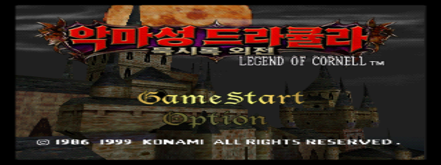
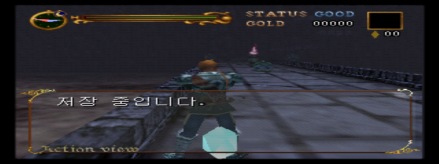
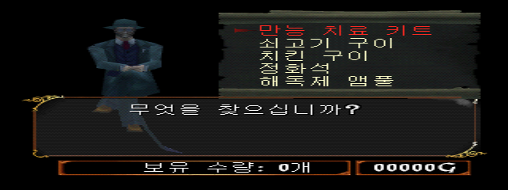
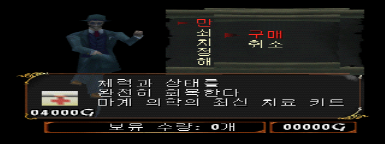
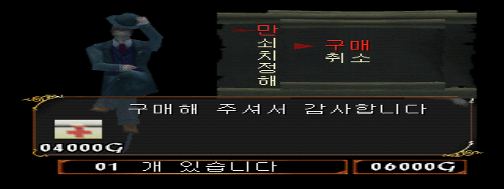
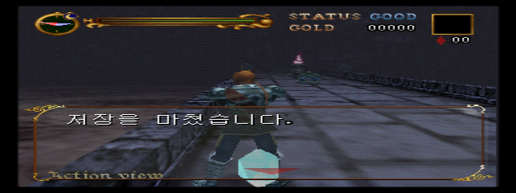
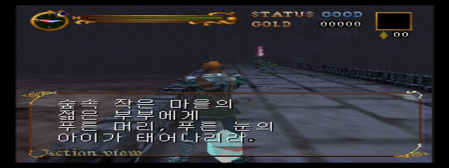

**악마성 드라큘라 묵시록 외전 · LEGEND OF CORNELL · N64 일본판 한국어 패치 V0.6.1**

일본어 텍스트 **1,665구간**과 일본어 타이틀 로고를 한국어로 바꿨습니다. 영어 메뉴·영문 부제·영어 음성은 보존합니다. 띄어쓰기는 **반각 공백 U+0020, 8픽셀**이며 한글 글자는 16픽셀입니다.

**V0.6.1은 전체 재검수와 UI 잘림 수정판입니다.** 전체 1,665구간(고유 원문 1,410개, 원문·번역 쌍 1,420개)을 다시 대조하고 65구간을 수정했습니다.

- 저장 진행 문구가 **'장 중입니다'**로 보이던 시작 주소 오류를 수정했습니다. 예언 문구와 헨리 안내 제목의 같은 오류도 고쳤습니다.
- 상점 하단 안내를 **'보유 수량: 0개'**로 바꿔 소지금 칸과 겹치지 않게 했습니다. 구매 후 보유 개수도 확인했습니다.
- 상점·아이템 설명을 실제 208px 폭 안에 재배치했습니다. 보유 안내는 128px, 일반 대사는 240px 제한을 검사합니다.
- 원본 글자를 직접 확인해 **'붉은 눈' → '푸른 눈'** 등 오역을 바로잡고, 조사·버튼 이름·숫자·대기 명령 전후의 공백을 다듬었습니다.

[**Windows EXE 패처 다운로드**](https://github.com/OldManCraveGuitars-bit/N64-Akumajou-Dracula-Mokushiroku-Gaiden-Legend-of-Cornell-Kr/releases/download/V0.6.1/N64-Legend-of-Cornell-Kr-V0.6.1-Patcher.exe) · [Windows ZIP](https://github.com/OldManCraveGuitars-bit/N64-Akumajou-Dracula-Mokushiroku-Gaiden-Legend-of-Cornell-Kr/releases/download/V0.6.1/N64-Legend-of-Cornell-Kr-V0.6.1-Windows.zip) · [BPS](https://github.com/OldManCraveGuitars-bit/N64-Akumajou-Dracula-Mokushiroku-Gaiden-Legend-of-Cornell-Kr/releases/download/V0.6.1/Legend-of-Cornell-Korean-V0.6.1.bps) · [텍스트 편집기](https://github.com/OldManCraveGuitars-bit/N64-Akumajou-Dracula-Mokushiroku-Gaiden-Legend-of-Cornell-Kr/releases/download/V0.6.1/Text-Tool-V0.6.1.zip) · [스크린샷](https://github.com/OldManCraveGuitars-bit/N64-Akumajou-Dracula-Mokushiroku-Gaiden-Legend-of-Cornell-Kr/releases/download/V0.6.1/Screenshots-V0.6.1.zip) · [SHA256 목록](https://github.com/OldManCraveGuitars-bit/N64-Akumajou-Dracula-Mokushiroku-Gaiden-Legend-of-Cornell-Kr/releases/download/V0.6.1/SHA256SUMS.txt)

1. EXE를 실행하고 일본판 원본 롬을 선택합니다. Python 설치는 필요 없습니다.
2. 새 출력 경로를 정한 뒤 **한글 패치 적용**을 누릅니다.
3. 결과 해시를 확인하고 새 `.z64`를 부팅합니다.
4. 게임 안의 저장 데이터를 불러옵니다. 다른 빌드의 빠른 저장 상태는 사용하지 마세요.

원본은 **16 MiB**, 결과는 **32 MiB**입니다. EXE는 `.z64/.v64/.n64`의 바이트 순서를 자동 인식하고 원본과 기존 출력 파일을 보존합니다. 일반 BPS 프로그램은 big endian `.z64` 원본에 적용하세요. 저장 방식 자동 인식 실패 시 **EEPROM 16K (16 Kbit / 2 KiB)**를 지정합니다.

지원 원본: **Akumajou Dracula Mokushiroku Gaiden - Legend of Cornell (Japan)** / 해외판 제목: Castlevania: Legacy of Darkness. 원본 정규화 **SHA1**: `50439acb5784bea3a4bbba5188c2aeaa1442099d`

| 대상 | SHA256 |
| --- | --- |
| 원본 .z64 (big endian 정규화) | `51a0443883f3f94b20b6fb9a8688631c51bc7feafb143c51e48dc7198adfd1ca` |
| 제공된 원본 (v64 순서, 확장자는 .n64) | `c90e4e11e90a8688d655f59a3ad069814cfa24c2b55e5a959588b03dc4585a65` |
| 한국어 결과 .z64 | `935fbdb3be00173817d43f79a85592cc46e74c6d6014b1d99cda47933449c2d4` |
| Windows EXE | `4af422cd14c662e2543bb974f971d0e79cbad743487ea63ad6856a9b4d000a93` |
| BPS | `5534424737d1787296b8e7e377a1681147890c89b2a8c49f7de7932752a48054` |
| Windows ZIP | `5039731516a54e0f8ebd5151216970a3cfe1ed64113e07780fb0558c59c24cd9` |

473개 자산·47개 지역 데이터·103개 텍스트 풀, N64 체크섬, 영어·음성 보존, 전체 줄 폭과 페이지 높이를 검사했습니다. 최종 ROM에서 **31개 번역 지역·네 캐릭터·상점·저장/새 부팅 불러오기·메뉴·텍스트 출력 등 44개 실행 검사**를 통과했습니다. EXE의 세 바이트 순서 적용, 오류 차단, GUI, 편집기의 동일 결과 재빌드도 검사했습니다.

지역·메뉴 요청과 대사 출력에는 QA용 에뮬레이터 RAM을 사용했습니다. **모든 캐릭터의 모든 분기를 처음부터 끝까지 조작해 완주한 검증은 아닙니다.** 배포 ROM에는 QA용 이동·문구 출력 기능이 들어 있지 않습니다.

짧게 지나가는 저장 안내를 매 프레임 기록해 첫 글자까지 정상 표시되는 것을 확인했습니다. [V0.6에서 재현한 수정 전 화면](docs/screenshots/12-before-saving.png)과 비교할 수 있습니다.

보유 안내와 소지금 칸이 겹치지 않습니다.

아이템 효과를 유지하면서 설명을 창 안에 배치했습니다.

실제 구매 후 개수·잔액 표시

게임 내부 저장 완료. [새 부팅 후 불러오기](docs/screenshots/04-fresh-load.png), [일시정지 메뉴](docs/screenshots/05-inventory.png)도 확인했습니다.

원본의 碧眼(푸른 눈)을 확인해 수정했습니다. 이 화면과 [헨리 안내 제목](docs/screenshots/10-henry-title.png), [예언 도입 문구](docs/screenshots/11-prophecy-title.png)는 실제 MFDS 텍스트 엔진에 QA 문구를 요청한 출력 시험이며, 자연스러운 컷신 진행 장면은 아닙니다.

텍스트 도구는 ZIP을 풀어 `Cornell_Korean_Editor.exe`를 실행하고 첫 실행에 지원 원본을 선택합니다. 원문·번역·ID 검색, 실제 글꼴 미리보기, Ctrl+S 저장, 영어·표시 폭·할당량 검증과 ROM 빌드를 지원합니다. 소스 실행은 Python 3.11 이상과 Pillow가 필요합니다. 검색용 일본어 전사에는 오독이 있을 수 있으므로 원문 이미지도 확인하세요.

패처 소스: `python patcher_app.py` 
EXE 빌드: `python -m pip install -r requirements-build.txt` 후 `scripts/build_exe.ps1` 
테스트: `CORNELL_TEST_ROM` 환경 변수에 지원 원본을 지정하고 `python -m unittest discover -s tests -v` 
완성 EXE 검사: `python scripts/verify_exe.py "원본 롬 경로"`

[이번 검수 기록 JSON](docs/proofreading-2026-11-15.json) · [변경 전후와 사유](docs/proofreading-2026-11-15.txt) · [주소 검사](docs/text-entry-audit.json) · [최종 검증](docs/validation.json) · [배포 파일 해시](docs/release-files.json) · [스크린샷 설명](docs/screenshots/README.txt)

[이전 V0.6 릴리스](https://github.com/OldManCraveGuitars-bit/N64-Akumajou-Dracula-Mokushiroku-Gaiden-Legend-of-Cornell-Kr/releases/tag/V0.6)는 보존했습니다. 원본 ROM·완성 ROM·세이브·에뮬레이터 상태는 저장소와 배포 파일에 포함하지 않았습니다. 게임의 권리는 원 권리자에게 있습니다.

구조 참고: [fliperama86/cvlod_recomp](https://github.com/fliperama86/cvlod_recomp), [k64ret/cv64](https://github.com/k64ret/cv64).
