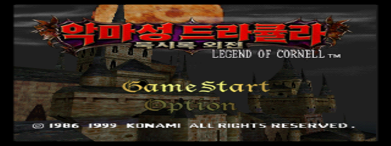

악마성 드라큘라 묵시록 외전 / LEGEND OF CORNELL 일본판 한국어 패치 **v0.65**입니다.

- '장 중입니다' → **'저장 중입니다.'**: 앞 글자를 건너뛰던 주소 오류와 같은 유형의 두 문구를 수정했습니다.
- 상점 보유 안내 **'보유 수량: 0개'**, 소지금 칸, 아이템 설명의 잘림을 고쳤습니다.
- 1,665구간 전체를 다시 대조하고 오역·조사·띄어쓰기 등 **65구간**을 수정했습니다.
- 공백은 **U+0020 반각 8px**입니다. 영어 메뉴·영문 부제·음성은 유지합니다.

Windows x64: `N64-Legend-of-Cornell-Kr-v0.65-Patcher.exe` 또는 `N64-Legend-of-Cornell-Kr-v0.65-Windows.zip`. Python 설치 없이 실행합니다. 일본판 원본에 적용하고 새 ROM을 부팅한 뒤 게임 내부 저장을 불러오세요. 원본/기존 출력은 덮어쓰지 않습니다. 원본 16 MiB → 결과 32 MiB, 세 바이트 순서를 자동 인식합니다.

`Legend-of-Cornell-Korean-v0.65.bps`는 big endian .z64 원본용입니다. `Text-Tool-v0.65.zip`는 첫 실행에 본인의 원본이 필요합니다. 스크린샷·변경 내역·검증·SHA256 목록도 제공합니다.

원본 정규화 SHA1: `50439acb5784bea3a4bbba5188c2aeaa1442099d` 
원본 정규화 SHA256: `51a0443883f3f94b20b6fb9a8688631c51bc7feafb143c51e48dc7198adfd1ca` 
제공된 원본(v64 순서) SHA256: `c90e4e11e90a8688d655f59a3ad069814cfa24c2b55e5a959588b03dc4585a65` 
한국어 결과 SHA256: `935fbdb3be00173817d43f79a85592cc46e74c6d6014b1d99cda47933449c2d4`

31개 지역·네 캐릭터·상점·저장/새 부팅 불러오기·메뉴·텍스트 출력 등 최종 ROM 실행 검사 44건과 EXE/편집기 검사를 통과했습니다. 모든 플레이 분기를 완주한 검증은 아닙니다. 일부 실행 검사는 QA용 RAM 요청을 사용했습니다.

[상세 내용·스크린샷·검수 기록](https://github.com/OldManCraveGuitars-bit/N64-Akumajou-Dracula-Mokushiroku-Gaiden-Legend-of-Cornell-Kr#readme). V0.6은 별도 보존했습니다. 원본/완성 ROM은 배포 파일에 포함하지 않습니다.
